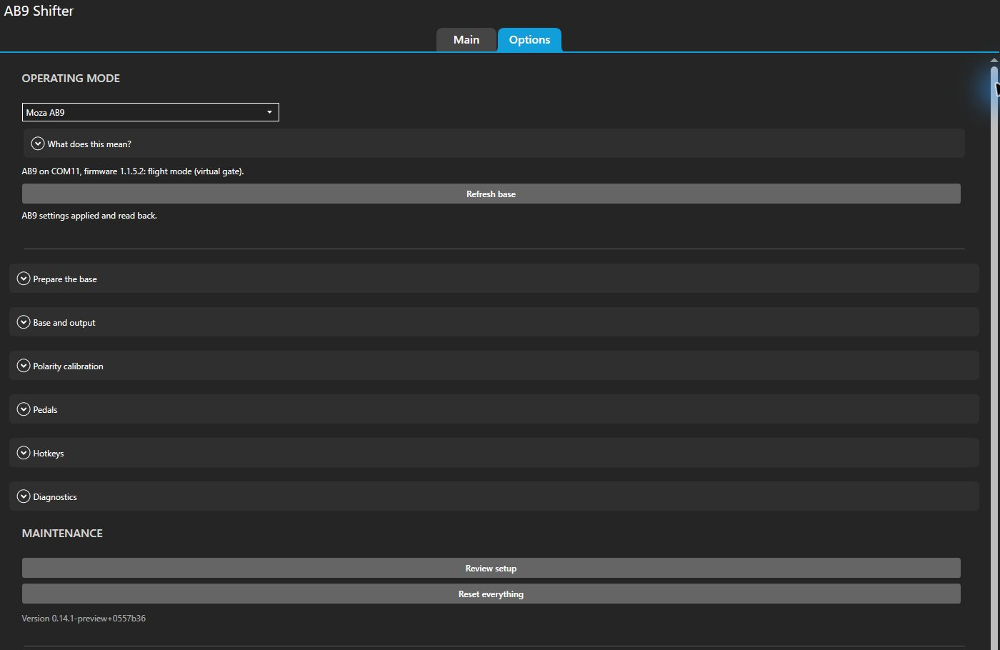
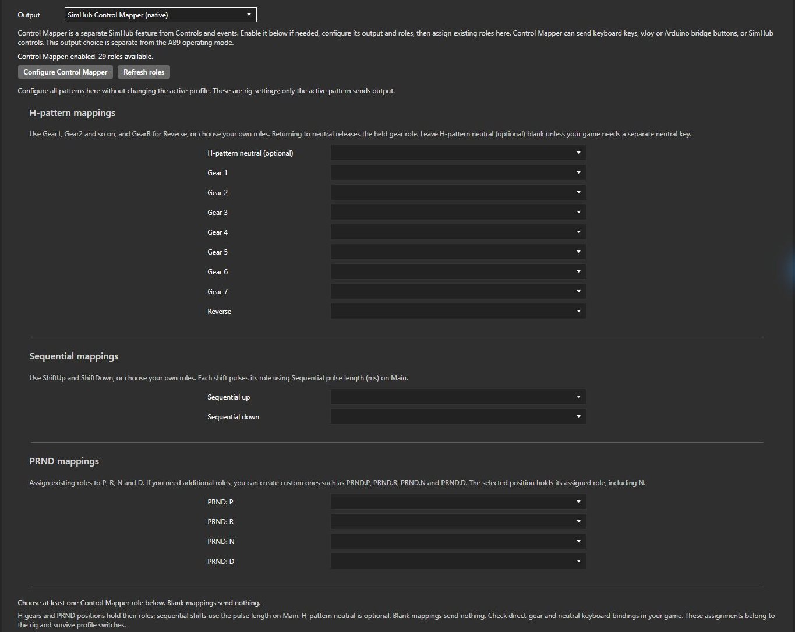
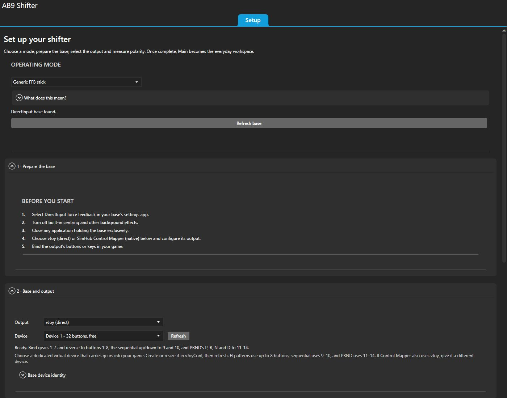
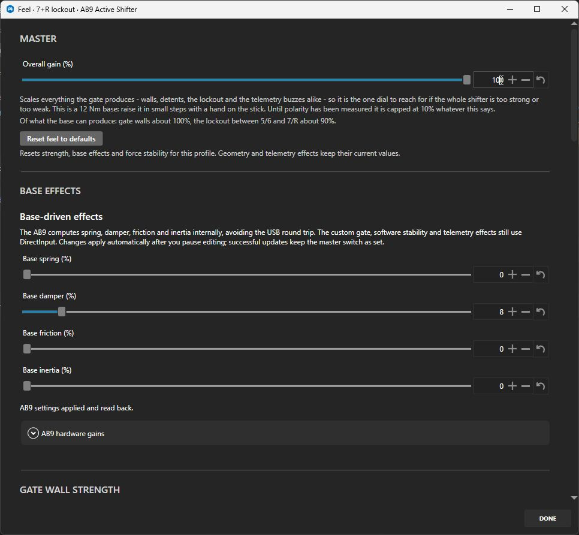

# Tuning guide

After first-run **Setup**, **Main** holds your profile, pattern, status and live monitor. Open
**Geometry** for positions, widths, travel and detection; **Feel** for strengths and resistance;
**Effects** for game-driven feedback. Geometry keeps its live monitor fixed above the scrolling
controls. **Options** holds mode, device/output, recalibration, pedals, hotkeys and diagnostics.
Main's **Automatic profile switching** and **Sharing and button mapping** sections open
independently; vehicle IDs stay separate from the compact action buttons.

For installation and the first-run walkthrough, start with [setup guide](setup.md).
**Options → MAINTENANCE → Review setup** expands the checklist again without resetting it.
**Done** closes a tuning editor; settings have already applied as you changed them.

| To change… | Open… |
| --- | --- |
| Profile, pattern, master switch, free stick or automatic profile selection | **Main** |
| Travel, gate width, corridors, mouths, detection or lockout placement | **Main → Geometry…** |
| Gain, base effects, wall/detent/lockout strength or stability | **Main → Feel…** |
| Game feedback, clutch behavior, effect groups or Lever routing | **Main → Effects…** |
| Mode, device identity, gear output or calibration | **Options → OPERATING MODE**, **Base and output**, **Polarity calibration** |
| Recovery when a game interrupts the base | **Options → Base and output → Automatically retake the base** |
| Clutch pedal source or binding | **Options → Pedals** |
| Profile cycling, enable/panic or lockout keys | **Options → Hotkeys** |
| Live readings, traces or loop rate | **Options → Diagnostics** |
| Setup review, reset, version checks or notices | **Options → MAINTENANCE**, **UPDATES**, **About and acknowledgements** |

The rig's three-way mode switch chooses **Generic FFB stick**, **Moza AB9** or **Moza AB9 native H-Pattern**.
Both virtual modes share the gate and all extra plugin effects. Generic uses DirectInput base
effects; Moza AB9 uses the basic effects supported onboard by Cockpit. Firmware H-pattern
exposes only device status and the mode switch, with plugin output and tuning unavailable.

Opening **Feel** reads the AB9's native settings once. Leaving it open does not poll native configuration;
use **Options → Refresh base** to request another read. The displayed native status is the last
checked snapshot. Startup and setting changes retain their mode checks and write verification.
Attachment warnings update every five seconds through controller and port-name enumeration,
including while the master switch is off; these checks never open the configuration port.

Virtual dials apply on the next FFB tick. The seven onboard dials apply automatically after
500 ms without another edit, and selecting a profile applies its onboard values too. Ordinary
changes preserve the master switch: buttons and forces pause for the write, output ownership
is retained, and the base resumes after the
latest values pass readback, provided it was enabled and you have not turned it off or pressed
panic. Setup, mode changes, calibration and failed writes leave output off.
Virtual force percentages are scaled by **Overall gain**; until polarity is confirmed its
effective value is capped at 10%. Hardware gains and onboard resistance are separate scales;
unconfirmed polarity also caps requested hardware torque at 10% and keeps the onboard spring off.

Setup completion persists. Losing the base or selected output shows connection status on the working
screen rather than reopening first-run Setup. Use Options to change the rig or measure again.

**Shifter enabled** on Main is the master switch for the base and selected gear output.
**Using the master switch and free stick** explains the two controls. While enabled, output
acquisition and recovery continue independently of the base connection. A base restart clears
buttons while its position is unavailable, retains the vJoy device, and resyncs gear output on
reconnect. Silent loss of vJoy ownership is checked once per second and reacquired using the
output retry schedule; no output-device reselection is needed. Turning the master off clears
buttons and releases both devices. Firmware **Moza AB9 native H-Pattern** also releases plugin output.
**Release all forces (free stick)** removes plugin forces while keeping its connections.

**Automatically retake the base** under **Base and output** defaults on. Exclusive-access losses
retry after one second, then failed opens back off to two and five seconds. Turn it off if retaking
disrupts a particular game: exclusive-access losses then wait until no game is reported running.
The setting belongs to the rig, survives profile switches and is excluded from shared profiles.
Changing it while disconnected takes effect without cycling **Shifter enabled**. Turning the
master off still releases everything and prevents recovery until it is switched on again.

## Options and plugin updates

**UPDATES** appears on **Setup** before completion and on **Options** afterwards. Its preferences
belong to the app rather than any profile. **Check for updates automatically** defaults on and checks
the latest stable GitHub release at startup and every six hours. **Check now** checks immediately
and shows a previously dismissed version again. **Release channel: Stable** excludes previews;
the installed version, check status and **Last checked** time appear here too.

The banner above every tab offers **Install update**, **Open release notes**, and **Dismiss**.
It uses the plugin's existing neutral panel styling and inherited text colour; its buttons use
the same SimHub controls as the rest of the settings page.
The same controls and **What's new in v…** release notes appear on Options. Install verifies and
replaces the plugin DLL while the current version keeps running, then changes the action to
**Restart SimHub**. Restart when you are ready to stop the current session; it saves settings
and uses SimHub's usual shutdown. Profiles, pedal binding and measured polarity survive.
Dismiss hides only that version's banner, and a later release gets a new banner. The update
remains accessible from Options. A failed check or download appears in the status so it can be
retried; a release with no verified DLL can still be opened for manual installation.

## Setup and gear output

**Setup → Base and output → Output** selects **vJoy (direct)** or **SimHub Control Mapper
(native)**. After setup the same controls live under **Options → Base and output**. This choice
is independent of the **OPERATING MODE** selector: both virtual modes support either output.
Firmware **Moza AB9 native H-Pattern** uses the base's own buttons and hides plugin output controls.

Direct vJoy uses the **Device** picker and **Refresh** to choose its virtual controller;
14 buttons cover all patterns. Keep its device separate from any vJoy device used by Control
Mapper. The native choice always shows mappings for all patterns, a feature status,
and **Refresh roles**. The status checks whether Control Mapper is loaded; an enabled mapper
with no roles is reported separately from a disabled feature. **Controls and events** is a
separate SimHub page. If disabled, **Enable Control Mapper and restart SimHub** enables the
feature and requests SimHub's normal restart. If its feature setting is already enabled but
the plugin is not loaded, the button reads **Restart SimHub to load Control Mapper**. On a host
that does not expose its feature setting, use SimHub's **Add/remove features** and restart;
unlock kiosk mode first if it is locked.

**Configure Control Mapper** opens SimHub's mapper page once loaded. Choose **Assign roles**
and create roles there, including simulated keys under **Keyboard** for keyboard output.
Choose its output, then return and **Refresh roles**. Choose or type an existing role here;
typing does not create a role. Blank mappings send nothing. Roles can drive keyboard keys,
controller buttons through Control Mapper's vJoy or Arduino bridge, or SimHub controls.

**H-pattern mappings** shows **Gear 1** through **Gear 7** and **Reverse**, regardless of the
selected pattern. **H-pattern neutral (optional)** sends a held neutral role for games that need
a separate neutral key. **Sequential mappings** shows **Sequential up** and **Sequential down**;
**PRND mappings** shows
**PRND: P**, **PRND: R**, **PRND: N**, and **PRND: D**. H gears and selector positions hold their
roles, and sequential uses Main's **Sequential pulse length (ms)**. Verify keyboard direct-gear
and neutral bindings in the game. Missing roles are reported under the mappings.

All three groups and their instructions stay visible without changing **Pattern**. For PRND,
assign existing Control Mapper roles to each position's row. Custom roles such as `PRND.P`,
`PRND.R`, `PRND.N` and `PRND.D` are optional if you need additional assignments; configure
their keys or controller buttons in Control Mapper, then **Refresh roles**.
N holds its own role until the selector moves to another position. In an H pattern, returning
to neutral releases the gear role; leave **H-pattern neutral (optional)** blank when released
gear buttons represent neutral in the game. For sequential output, the guide suggests
`ShiftUp` and `ShiftDown` for **Sequential up** and **Sequential down**.

First-run **Finish setup** requires measured polarity and an available direct vJoy device or
the loaded Control Mapper feature with at least one available role for the active pattern. Role availability does not
prove that Control Mapper's external device or game bindings work; check those there and in the
game. Once setup is complete, output loss leaves Main available and updates its connection status.
Main's **Sharing and button mapping** follows the selected output.

The output choice and role assignments belong to the rig and survive profile and operating-mode
changes. Editing mappings or changing backend releases the previous output before publishing the
current lever state when the active output is affected. Editing another pattern's mappings
preserves the current output and held roles. Only the active pattern sends output, and its
mappings determine readiness. Calibration clears every role, including optional H neutral. AB9 onboard
configuration pauses the selected output along with the forces and resumes it through the same
checked transaction as direct vJoy.

## Using the tuning forms

Geometry and Feel use one bordered block per setting. Each block says what the control changes
and which direction to turn it. Start with one change, try a few shifts, then decide whether to
keep it.

**Distances use a single 0–100 scale.** Lower means the short or tight end of that control;
higher means the long or wide end. Each dial has its own range, so numbers on different dials
are not distances you can compare directly. Strengths that are actual percentages keep **(%)**;
strengths with a smaller tuning range use **(0–100)**. Time, frequency, RPM and gear-confirmation
samples keep their natural units. The old raw/percentage display switch is gone.

Software strengths in **Feel** adjust in **0.1 steps**, including strengths with a smaller
tuning range. **Base spring (%)**, **Base damper (%)**, **Base friction (%)** and **Base inertia (%)**
use 0.1 steps with the Generic provider and whole percentages in Moza AB9 mode, matching the
onboard controls. **Maximum Torque Output (%)**, **Overall Force Feedback Intensity (%)** and
**Game Force Feedback Gain (%)** also use whole percentages. Time and sample counts keep their
natural steps. Geometry readouts use tenths; controls that need larger steps use a clean
increment rounded up to a tenth. Existing
profiles keep their full saved precision: the rounded display
does not rescale the profile. If a saved value is outside a control's usual adjustment range, a
note appears and the value is kept until you adjust it.

**Right-click a slider to undo its last adjustment.** A red marker means it differs from the
value present when this profile was opened. Reset buttons restore the original defaults through
the same scale. Geometry changes position and travel; Feel changes force and response.

## A useful order for an H-pattern tune

**Gear layout** follows the selected pattern. H gates offer **Odd gears toward me instead
of away**. Sequential offers **Pull toward me to shift up**: off means push up/pull down,
on means pull up/push down. PRND offers **Park toward me instead of away**. Game bindings
continue to follow the gear or shift action.
The sequential monitor's +/− labels and live status follow that same setting: with pull-to-up
enabled, + is at the end nearest you. Switching the layout requires a return to neutral before
the next shift can fire.

1. Start from a preset close to what you want.
2. In Geometry, set **Pattern width (0–100)** and **Gear throw length (0–100)**.
3. Set **Neutral tunnel width (0–100)** for comfortable movement across neutral, then
   **Gear-slot width (0–100)** for the wiggle room you want while in gear.
4. In Feel, start low with **Overall gain (%)**. Use the side-wall and end-stop controls to
   give the lever the firmness you want.
5. Fine-tune **Wall bite distance (0–100)** and **Gate wall fade width (0–100)** for contact
   and corners. Change one at a time.
6. Open **Advanced gear detection** only if the game registers or releases gears at the wrong
   point, or the openings are hard to find.

For a realistic hard-gate feel, aim toward zero **Wall bite distance**. Very short distances
can cause oscillation, so increase it until the gate is stable and feels right to you.
For crisp gear openings, keep **Gate wall fade width** narrow. Very small widths can cause
chatter or oscillation at the corners; widen it until contact is smooth and stable. Too wide
can feel vague.

## Reading the gate monitor

The same gate appears on Main and at the top of Geometry. It stays visible while the controls
scroll, so you can see the effect of a change.

| What you see | What it means |
| --- | --- |
| Blue strip through neutral | The actual free forward/backward room selected by **Neutral tunnel width**. At zero it becomes a centre line. |
| Grey outline and dashed neutral boundary | Where the lever is treated as returning to or leaving neutral. These are separate from its free wiggle room. |
| Gear-slot outlines and widened entrances | The room the lever has inside a slot and its eased entrance. |
| Hatched tunnel ends | Edge walls outside the usable narrowed gate. They disappear at full pattern width or when **Outer edge walls (%)** is zero. |
| Solid blue marks across a slot | Where a gear engages. |
| Dashed blue marks across a slot | Where the game releases the gear as you return. |
| Thick grey bar | The gear-slot end stop, when one is enabled. |
| Grey hatching beyond a gear-slot stop | Unused travel past the configured stop. The active green outline ends at the stop too. With the end stop disabled, the whole slot remains available. |
| Orange band | A lockout, guarding the selected gear or gap. |
| White dot | The live lever position when connected. |

The previews read the same force and geometry model as the lever. Some settings need space
to work: if the selected gate leaves too little room, a short notice shows the effective
0–100 value and suggests what to change. The requested tune stays saved.

## Base effects

In **Moza AB9** mode, prefer **Base damper (%)** and **Base friction (%)** before adding
**Software damping (0–100)** or **Wall friction (0–100)**. The first pair is applied in the
base. The software pair remains available for extra tuning, and the reminder appears beside
each control in AB9 mode.

### Base effects: one tune, two providers

The **OPERATING MODE** selector offers **Moza AB9**, **Generic FFB stick**, and
**Moza AB9 native H-Pattern** with the base connected or disconnected and the master switch on
or off. **What does this mean?** expands a bulleted explanation of the three modes; it starts
collapsed. Choosing a mode saves the preference and leaves plugin output off. **Base is not found**
appears on Setup/Options and Main when the selected base is missing; forces and gear presses stay
inactive until fresh input is available.

**Moza AB9** uses internal AB9 base settings alongside the plugin's virtual gate, calibration and
selected gear output. **Prepare base** selects flight mode and verifies those settings, requiring
a genuine AB9 with firmware **1.1.5.2 or newer**. Use **Refresh base** after closing Cockpit,
Pit House or AZOM's AB9 connection. **Generic FFB stick** uses DirectInput only; choose it for
other bases and follow their manual setup checklist. **Moza AB9 native H-Pattern** uses firmware
buttons, is configured in **Moza Pit House / AZOM**, and disables plugin output and tuning.
The **Prepare base** button and its explanation appear only in **Moza AB9**. Generic mode
shows **BEFORE YOU START** as five numbered steps: select DirectInput feedback, turn off
built-in centring/background effects, close apps holding the base exclusively, configure the
chosen output, and bind its buttons or keys in the game.

**Measure polarity** is required for both virtual modes: **Moza AB9** still drives the custom
gate through DirectInput while using onboard basic effects, and **Generic FFB stick** uses
DirectInput throughout. Calibration measures push and spring direction on each axis; the 10%
gain cap remains until confirmed. Firmware **Moza AB9 native H-Pattern** needs no plugin
calibration and hides these controls because plugin output is disabled.

Feel labels the AB9's basic effects **Base-driven effects**: they are processed internally by
the base and avoid the plugin's USB round trip. Generic FFB stick provides the same controls
through DirectInput. Profiles and presets keep exactly the same percentages in both modes;
there are no native copies or separate preset sets. Physical strength can differ by provider.

| Shared base control | Default | Meaning |
| --- | --- | --- |
| Base spring (%) | 0% | Global centring |
| Base damper (%) | 8% | Base damping; preserves the existing DirectInput coefficient of 800 |
| Base inertia (%) | 0% | Base inertia |
| Base friction (%) | 0% | Base friction |

Moza AB9 also exposes hardware torque, overall intensity and game gain, each defaulting to
100%. Generic mode ignores these hardware scales. The plugin's home spring, wall damping,
wall friction and game effects remain separate and available in both virtual modes.

Generic typed effects share effective gain and are released by free stick. The global spring
requires its own measured per-axis signs; rigs whose earlier calibration stored only constant
force signs must measure again before it activates. The existing gate calibration remains
valid and does not send the rig through first-run Setup again.

Onboard edits save and apply automatically after a short pause; there is no Apply button.
An update keeps the force-feedback toggle as set, while a failed write leaves forces off.
Setup and recalibration temporarily neutralize onboard conditions for the probes and leave
virtual output off afterward. Free stick releases plugin forces, while onboard resistance can
remain. Importing a profile applies its onboard values in Moza AB9 mode but keeps virtual
output disabled. [Native configuration](native-ab9.md) records the transaction ordering,
protocol evidence and current hardware verification limits.

## Geometry controls

### HANDBRAKE TRAVEL AND OUTPUT

| Control | What it changes |
| --- | --- |
| **Released position (0–100)** | Where the handbrake rests with no braking. This is shared by your profiles; set it to your actual released position. |
| **Full-pull position (0–100)** | Where a complete handbrake pull ends. It can be on either side of the released position and is shared by your profiles. |
| **Handbrake pull length (0–100)** | How much of your calibrated movement is used. Lower makes full braking arrive sooner; higher uses more of the pull. |
| **Free movement before braking (0–100)** | The small slack at the released end. Increase if braking does not fully release; too much delays braking on the next pull. |
| **Braking progression (%)** | How gently braking builds as you pull. Increase for more fine control at the start of the pull. |

### PATTERN SIZE AND LAYOUT

| Control | What it changes |
| --- | --- |
| **Pattern width (0–100)** | How far apart the gear pairs feel. Lower gives a compact gate; higher gives a wider sweep. At 100 the outer pairs use the full sideways travel. |

### FREE MOVEMENT AND WALL CONTACT

| Control | What it changes |
| --- | --- |
| **Sideways freedom (0–100)** | Room to move left and right in the sequential, PRND or handbrake lane. Increase for more freedom; zero guides the lever along a centre line. |
| **Gear-slot width (0–100)** | Sideways wiggle room while in gear. Increase for roomier slots; lower it for tighter guidance. If a tight slot trembles, widen it or reduce its side-wall force in Feel. |
| **Neutral tunnel width (0–100)** | Forward/backward wiggle room while sliding left and right through neutral. Increase for more room; zero guides the lever along a centre line. The blue monitor band shows the space in use. |
| **Wall bite distance (0–100)** | How gradually resistance builds as you press into a wall. Lower feels harder and sharper; higher feels softer. Set the maximum wall force in Feel. |
| **Gate wall fade width (0–100)** | How gradually the wall closes beside a gear opening while you move sideways through neutral. Lower gives a sharper corner; higher gives a gentler edge. |

### GEAR TRAVEL

| Control | What it changes |
| --- | --- |
| **Gear throw length (0–100)** | How far the lever moves from neutral to a seated gear. Lower makes a shorter throw. Enable Gear-slot end stop in Feel to give the shorter stroke a definite bottom. |
| **Room past the seated gear (0–100)** | Extra travel after the gear seats, before its end stop. Lower gives a shorter, more definite finish; higher leaves more room to settle. |

### SEQUENTIAL TRAVEL

| Control | What it changes |
| --- | --- |
| **Travel before the shift click (0–100)** | How far you push or pull before a sequential shift registers. Lower makes a short, quick stroke; higher requires more travel. |
| **Travel after the shift click (0–100)** | How far the lever can move after a sequential shift registers, before meeting the end stop. |

### GEAR ENTRANCES

| Control | What it changes |
| --- | --- |
| **Gear-entry easing length (0–100)** | How far into the slot its softened entrance continues. Increase if the easing feels too brief during a quick shift. |
| **Gear-entry opening (%)** | How much the entrance opens to help your hand slide into a gear. Increase for more forgiving entries. |

### PRND LANE AND LOCKOUT

| Control | What it changes |
| --- | --- |
| **PRND selector travel (0–100)** | How far apart P, R, N and D sit along the lever travel. Lower makes a compact selector; higher spreads the positions out. |
| **Free movement at each PRND position (0–100)** | Wiggle room while sitting in P, R, N or D. Increase if a selected position feels too tightly pinned. |
| **PRND lockout width (0–100)** | How far you must move through the guarded gap. Wider makes it take a more deliberate movement. |

### LOCKOUT POSITION AND WIDTH

| Control | What it changes |
| --- | --- |
| **Lockout width (0–100)** | How far you must push through the lockout. Wider makes accidental crossings harder, even during a quick movement. |
| **Width of clicks between gear pairs (0–100)** | How broad the small bumps between gear pairs feel. Lower gives short clicks; higher gives broader rises. |

### Advanced gear detection

| Control | What it changes |
| --- | --- |
| **Returning to neutral (0–100)** | How close to the neutral lane the lever needs to return before it is treated as back in neutral. Increase if normal hand movement struggles to find neutral. |
| **Leaving neutral (0–100)** | How far you can push or pull before the lever is treated as leaving the neutral lane. Increase if it switches too quickly from sliding across neutral to entering a gear. |
| **Outside gear-pair openings (0–100)** | How much room you have to line up with the first and last gear pairs. Wider makes their entrances more forgiving. |
| **Middle gear-pair openings (0–100)** | How much room you have to line up with the middle gear pairs. Wider makes their entrances more forgiving. |
| **Room beside the lockout (0–100)** | Space to rest beside the gear pair next to the lockout before meeting its resistance. This matters only for a lockout between gear pairs. |
| **Travel before a gear engages (0–100)** | How far you must push or pull before the game registers the gear. Higher requires a longer movement; lower registers it sooner. |
| **Return needed to release a gear (0–100)** | How far you must bring the lever back before the game releases the gear. Increase if a small movement drops the gear too easily. |
| **Smoothness between gear pairs (0–100)** | Softens the sideways change in guidance as you pass from one gear pair to the next. Increase if it feels notchy; too much can feel vague. |
| **Gear confirmation delay (samples)** | Waits for a few steady readings before registering a gear. Increase only if gears register by accident; extra delay makes shifting less immediate. |

## Feel controls

### MASTER

| Control | What it changes |
| --- | --- |
| **Overall gain (%)** | Makes the whole shifter lighter or stronger, including feedback effects. Raise it gradually with a hand on the lever. An uncalibrated base stays limited to 10%. |

### BASE EFFECTS

| Control | What it changes |
| --- | --- |
| **Base spring (%)** | Pulls the lever toward the base centre. Keep it low if you want the lever to rest naturally in a gear. |
| **Base damper (%)** | Slows lever movement, like a damper on a real mechanism. Increase for a heavier, calmer movement; too much makes shifting sluggish. |
| **Base friction (%)** | Adds steady drag as the lever moves. Increase for a weightier mechanical feel; decrease for a freer lever. |
| **Base inertia (%)** | Makes the lever feel heavier when starting or stopping a movement. |
| **Maximum Torque Output (%)** | Sets the base hardware torque limit. Overall gain above still controls the strength of this profile. |
| **Overall Force Feedback Intensity (%)** | Adjusts the AB9 hardware strength. Prefer Overall gain for everyday profile tuning. |
| **Game Force Feedback Gain (%)** | Adjusts how strongly the AB9 applies the plugin effects. |

### GATE WALL STRENGTH

| Control | What it changes |
| --- | --- |
| **Gate wall between gears (%)** | How firmly the gate stops you pushing forward or backward between gear openings. |
| **Gear-slot side walls (%)** | How firmly the lever is kept inside a gear slot. In sequential, PRND and handbrake, this supplies the sideways lane walls. |
| **Forward/backward guide (0–100)** | The light resistance you feel pushing or pulling while lined up with a gear opening. Increase for more guidance; decrease for a freer entry. |
| **Outer edge walls (%)** | Stops the lever wandering beyond the first and last gear pairs on a narrowed gate. It has no effect at full pattern width. |

### GEAR END STOPS

| Control | What it changes |
| --- | --- |
| **Gear-slot end stop (%)** | How firmly each gear slot ends. Raise this to give a short-throw shifter a definite bottom; zero lets the lever travel to the base stop. |

### HANDBRAKE RESISTANCE AND RETURN

| Control | What it changes |
| --- | --- |
| **Pull resistance (%)** | How hard you need to pull the handbrake. |
| **Return strength (%)** | How firmly the handbrake returns to its released position. Return is limited to the pull resistance. |
| **Curve amount (%)** | How strongly the selected resistance curve is applied. Low feels more even; high makes the chosen curve more noticeable. |
| **Handbrake end stop (%)** | How firmly the lever stops at the end of the pull. |

### SEQUENTIAL STROKE STRENGTH

| Control | What it changes |
| --- | --- |
| **Shift click (%)** | The kick you feel when a sequential shift registers. Increase for a sharper click. |
| **Sequential end stop (%)** | How firmly the lever stops after the shift click. |

### PRND DETENTS AND LOCKOUT

| Control | What it changes |
| --- | --- |
| **PRND position clicks (%)** | Resistance as you move between P, R, N and D. Increase for more definite positions. |
| **PRND end stops (%)** | How firmly the lever stops beyond P and D. |
| **PRND lockout force (%)** | Resistance crossing the guarded gap between selector positions. Hard lockout modes set their own full strength. |

### CROSSING THE GATE

| Control | What it changes |
| --- | --- |
| **Lockout force (%)** | The effort needed to cross a push-through lockout, such as the guard before reverse. Hard lockout modes set their own full strength. |
| **Clicks between gear pairs (%)** | The small bumps you feel sliding past the ordinary gear pairs in neutral. |
| **Guidance toward gear pairs (0–100)** | The light pull that helps your hand line up with a gear pair while moving across neutral. |
| **Return toward 3rd/4th (0–100)** | Pulls a released lever toward the 3rd/4th gear pair in neutral. Lower this if the lever trembles there. |

### GEAR ENGAGEMENT FEEL

| Control | What it changes |
| --- | --- |
| **Resistance entering a gear (%)** | The resistance you push through before a gear clicks into place. In sequential, this sets resistance before the shift click. |
| **Pull into gear (%)** | The snick that draws the lever into a gear after you push through the entry resistance. |
| **Hold in gear (%)** | Keeps the lever seated after the shift. Increase if a seated gear feels too easy to pull out. |

### SOFTWARE STABILITY

| Control | What it changes |
| --- | --- |
| **Wall contact smoothing (ms)** | How gradually a wall pushes back after contact. Zero is immediate; a little smoothing can make contact calmer. |
| **Rebound absorption (0–100)** | Takes energy out of a bounce away from a wall. Increase if the lever kicks back too strongly. |
| **Wall friction (0–100)** | Adds grip while the lever is pressed against a gate wall. It stays free when you are clear of the walls. |
| **Software damping (0–100)** | Slows lever movement throughout its travel. Increase for a calmer lever; too much makes shifts feel heavy or sluggish. |

### Gear entrances and guards

**Gear-entry shape** chooses Square, Rounded or Angled. Square gives a plain opening;
Rounded softens both corners; Angled eases the route toward the next gear.
**Lockout position** chooses the guarded gear pair or individual gear. **Direction** chooses
which crossing meets resistance.

**Push through** lets a deliberate hand cross the guard. The hard modes require a release
action bound in **Options → Hotkeys**, and guarded H-pattern gears do not register until
released. A PRND selector always reports the position the lever physically reaches: its lockout
adds resistance rather than hiding that position from the game.

## Telemetry effects (Effects)

Open **Effects…** from Main. The editor uses SimHub's native ShakeIt controls. **Add effect**, **Add group** and
**Calibration** sit above the list; expanded rows have **Response filter**, **Live effects**,
**Effect frequency**, **High priority** and **Channels assignment**. Route feedback to **Lever**.
Use **Effects gain** and **Mute effects** above the editor for its master level, and
**Reset effects to defaults** to rebuild all rows. The selected shifter profile owns the tune.

The lever's overall gain, including its 10% unconfirmed-polarity cap, still applies. Ordinary
effects are silenced within 500 ms of stale/inactive telemetry or native output. The native
**Test** link can play without a game while the shifter is armed; enable the row, route it to
Lever, leave **Mute effects** off and **Release all forces (free stick)** off to feel it.

| Effect | Fires when | Notes |
| --- | --- | --- |
| Clutch grind | Pushing into an H-pattern gear with the clutch up while the engine turns | **Reject the gear while grinding** keeps the gear from registering and replaces the snick with the entry resistance plus **Balk wall (%)**. Press the clutch, or match RPM with **Float shifting** enabled, to release it. The core decision and wall remain immediate. Native response/gain/frequency shape the tone at the data rate. An engaged gear never grinds; sequential and PRND are exempt. |
| RPMs | Native RPM telemetry | Native RPM/response curve and low/high frequencies replace the former frequency-at-1000-rpm dial. Rendered frequencies are limited to 4–130 Hz. |
| Rev limiter | Revs ≥ **Starts at (% of redline)** | Silent when the game reports no plausible redline. |
| ABS Active / TC Active | The game's active flags | Native **Pulse duration (ms)** can extend a short event. Existing pitches migrate. |
| Road impacts | Native per-wheel road/impact telemetry | Replaces the old vertical-acceleration heuristic. Use native response and calibration; available data varies by game. |
| Clutch bite point | The clutch crosses the bite point, either way | Tells the hand where the drivetrain connects. Silent while the pedal moves without crossing, so riding the clutch stays quiet. Set the point itself in **Effects** — it is a property of the car, not of the pedals. |
| Gear shift | The game's reported gear changes | Native gear selection/debounce and pulse duration controls; confirms what the game accepted. |
| Custom property | **Property name (0-100)** → volume | Keeps the old exported-property bridge. Use native **Custom effect** from **Add effect** for formulas and additional sources. |

Existing profiles migrate all nine rows together, carrying enabled state, gain, frequency,
limiter/clutch settings and pulse duration. RPM pitch/response and road sensitivity have different
native models, so those need a feel retune; the old **Full volume at (G)** dial has no direct native
equivalent. Grind uses the native sine tone instead of the old jittered square wave. Ordinary
sources come directly from ShakeIt; four shifter sources appear under **AB9 shifter** in
**Add effect**. Native effects can also be grouped, reordered, copied and deleted.

### Float shifting (H patterns)

Open **Float shifting** above the native effect list and enable **Allow rev-matched shifts
without the clutch**. Enable the **Clutch grind** row and **Reject the gear while grinding**
inside it. **RPM match tolerance** defaults to 100 RPM; lower it for a narrower window, raise it
if the game accepts the shift but telemetry makes matching difficult. A matched window stays
open to 125% of this value for the current target only. The status line reports target RPM,
signed RPM error and source while approaching a slot. The extra balk and grinding soften as
the revs approach the target; the normal snick returns on a match. An unknown ratio needs
the clutch. The plugin cannot make a game accept a clutchless shift against its own rules.

There is one float-shifting model for every H-pattern gearbox. The RPM source changes with
available data; tolerance, refusal, balk and snick behavior are identical for reported,
configured and learned targets. The status names the source **Game telemetry**, **Configured
ratio** or **Learned ratio**. No truck mode needs to be selected.

ETS2/ATS use powered-wheel speed, differential and transmission ratios automatically, including
the game's range/splitter toggles. In **ETS2 / ATS H-shifter bindings**, **SCS handle positions for buttons
1-7, R** must agree with your game bindings. Default: `2,3,4,5,6,7,8,1`, with reverse at SCS
position 1 and forward gears at 2–8. Enter 0 for an unused button. Six-slot truck layouts may
need a different mapping depending on the game positions bound. Missing or ambiguous game slot
entries refuse to guess. Reverse float permission requires backward powered-wheel rotation.

When a game has no reported targets, **Learn ratios while driving in gear** collects ratios with the clutch fully
released and the game confirming the lever's gear. Give each gear at least a second above
10 km/h. Learning stays in this session and clears on vehicle, game, profile or manual-ratio
changes. Use another profile for a different gearbox on the same vehicle. ABS/TC, partial clutch,
telemetry gaps and unstable ratios prevent learning. Wheel slip without a reported TC event can
still make a learned ratio inaccurate; check the status and use configured values if necessary.
Disabling float shifting clears learning even with virtual output stopped; an off/on toggle
starts fresh when output resumes. Profile and manual-ratio changes do the same. A missing direct
pedal falls back to the game's clutch reading, and an old game reading cannot release stale-data
rejection merely because the pedal source is selected.

**RPM at 100 km/h, gears 1-7 (optional)** takes comma-separated values in gear order, such as
`12000,8000,5500,4000,3200,2700`. Measure steady RPM/speed with the clutch released and enter
`RPM × 100 / speed in km/h`. Blank, zero or invalid entries stay unknown. Configured values
override learning when the game does not report targets; game telemetry takes priority.
Road-speed matching needs at least 5 km/h; reverse uses the clutch because normalized road
speed commonly loses direction. Reported shaft-RPM targets can cover reverse in any game
whose adapter confirms the correct direction. An unknown reported mapping never falls back
to a ratio that might belong to a different gear.
These dials and truck bindings travel with a shared profile; learned ratios do not. **Reset
effects to defaults** disables float shifting and restores its default ratios/bindings. Float
shifting ships off in every preset. There are no throttle cuts or virtual pedal routing;
unloading a truck transmission remains the driver's and game's job.

Symptoms:

| Symptom | Dial |
| --- | --- |
| Grind never fires | Enable the row. In threshold mode lower **Clutch counts as pressed above (%)** if a pressed pedal reads low. Check the engine is running and the speed floor. |
| Grind fires in the garage / pit lane | Raise **Only grind above (km/h)**. |
| A gear registers despite grinding | **Reject the gear while grinding** is off, or the game itself needs no clutch — the rejection is ours, not the game's. |
| The grind feels like a lean, not a border | Raise **Balk wall (%)** — it stacks on the entry resistance while a shift is rejected. It only acts with rejection on. |
| Effects feel weak | Check **Effects gain**, row gain and Lever assignment, then overall gain and confirmed polarity. The shared vibration budget limits stacked effects. |
| Test is silent | Arm the shifter, enable the effect and Lever channel, turn **Mute effects** off, and leave **Release all forces (free stick)** off. Test does not bypass the force cap. |
| A buzz outlives the game | Only a running Test may play without a game; it expires. Otherwise the 500 ms cutoff applies — record a trace if a buzz remains. |

## The clutch (Options for the pedal, Effects for its profile tune)

Where the clutch reading comes from, and the one number that describes your car rather than your
hardware.

In **Options → Pedals**, **Read from** is **The game's telemetry** by default, which needs no
setup when the game reports the pedal. Switch to **The pedal itself** for either of two reasons:

- the game reports no clutch, so the grind has nothing to key on;
- the grind feels late — telemetry arrives at the game's update rate, tens of milliseconds old
  against a shift that is over in a couple of hundred.

The pedal is opened **non-exclusively**, so the game keeps reading it exactly as before. Press
*Press the clutch to bind it*, hold still a moment, then press the clutch fully and let it back up:
which axis, which direction it travels and how much slack it has at rest are all measured from that
one press. A pedal whose axis falls when pressed is detected and handled — nothing needs typing,
and there is no invert box to get wrong. The binding describes your rig, so it never travels in a
shared profile.

**Bite point** is where the clutch starts to pick up, as a percentage of travel. It cannot be
measured from the pedal — nothing in the motion marks it — so set it where the car actually bites.
Two things use it: the bite-point pulse on the Effects editor, and the grind's *fade* mode.

| Symptom | Dial |
| --- | --- |
| The grind is all-or-nothing, and feathering the clutch does nothing | Effects → **How the clutch decides** → *Fade across the pedal from the bite point*. Then set the bite point honestly, because that is where the fade ends. |
| The grind fades out too early or too late | The **bite point**, not the threshold — the threshold belongs to the other mode and is ignored while fading. |
| The bite-point pulse fires while I ride the clutch | It cannot: it is edge-triggered on the crossing. If you feel something there it is the grind or the engine hum. |
| The pedal reads 0% however hard I press | Wrong axis, or the pedals were rebound to a different device. Re-run the capture; the reading under the button shows the live value while you press. |

## The rail gate recipe

For a closely guided lever, set **Gear-slot width (0–100)** and **Neutral tunnel width (0–100)**
to zero. The lever then follows a centre line in each direction instead of resting in free space.
Start with moderate side-wall and gate-wall strength. If it trembles, lower the relevant wall
force or add clearance again. In AB9 mode, try Base damper before extra software damping.

## Symptom → dial

| What you feel or see | What to try |
| --- | --- |
| Gear pairs feel too far apart | Lower **Pattern width (0–100)**. |
| Too much sideways play while in gear | Lower **Gear-slot width (0–100)** gradually. |
| A gear trembles while seated | Widen **Gear-slot width** or lower **Gear-slot side walls**. |
| Neutral feels too tightly guided | Raise **Neutral tunnel width (0–100)**. |
| Corners kick or chatter | Raise **Gate wall fade width (0–100)** gradually. |
| Walls feel sharp or buzz at contact | Increase **Wall bite distance (0–100)**; in AB9 mode try Base damper first. |
| Walls feel soft or vague | Lower **Wall bite distance** gradually, checking for oscillation. |
| Reverse is too easy to enter | Increase the lockout force or width, or use a hard mode with a release action. |
| Shorter throw does not shorten the lever movement | Enable **Gear-slot end stop (%)** in Feel. |
| A gear engages before the movement feels complete | Increase **Travel before a gear engages (0–100)** under Advanced gear detection. |
| A small retreat releases a gear too easily | Increase **Return needed to release a gear (0–100)**. |
| A shift registers from a stray movement | Add a little **Gear confirmation delay (samples)**. |
| The lever feels sluggish everywhere | Reduce Base damper or Software damping. |
| The lever snaps back off walls | Increase Rebound absorption gradually. |
| A narrowed gate has no outer boundary | Raise **Outer edge walls (%)**. |
| Force feedback is unexpectedly light | Check Overall gain, the master switch and polarity calibration in Options. |
| Sequential, PRND or handbrake shakes sideways | Increase **Sideways freedom (0–100)** or lower its side-wall strength. |
| A limit notice appears | Follow the note in that setting's block; the gate may need more room for the selected shape. |

Force cannot guarantee the lever stays inside a slot. A held H gear releases through neutral;
pushing through a sideways wall does not select another gear. The game also needs its own
button bindings and clutch behavior set correctly.

## Handbrake

Choose **Handbrake (analog)** on Main or start from **(Preset) Handbrake (progressive)**.
Calibrate the released and full-pull positions in **Options → Handbrake travel calibration**.
Those positions belong to the rig and are shared by all profiles. Either pull direction works.
Release the lever after changing them or acquiring output before braking can arm.

In Geometry, **Handbrake pull length (0–100)** controls how much travel reaches full braking;
**Free movement before braking (0–100)** adds slack at rest; **Braking progression (%)** adjusts
how braking builds. In Feel, Pull resistance and Return strength set the lever weight.

**Resistance curve** chooses how that weight builds: Build later starts light, Build early
firms up sooner, Linear stays even, and S curve eases both ends. **Curve amount (%)** blends
the chosen shape in. Mechanical feel and braking response can be tuned separately.
The base spring is suppressed in this pattern so it does not pull toward the wrong rest point.

Analog handbrake uses vJoy Z. Enable that axis in vJoyConf and bind it in the game.
Control Mapper remains button-only. The handbrake preset also includes engine and rear-wheel
lock feedback in Effects.

## Presets, and why your profile just renamed itself

The eleven shipped tunes are marked `(Preset)` and stay at the bottom of the profile list.
Your profiles, including duplicates and imports, stay above them. Each group keeps its order.

Fresh installs select **(Preset) 7+R lockout (short throw, stiff, sport)**. Existing installs keep
their selected profile. The standard H gates, wide/narrow 5+R choices, sport short-throw gates,
truck gate, sequential choices, PRND and progressive handbrake offer different starting points.
**(Preset) 5+R (narrow, short throw, stiff, sport)** includes the captured sport tune and its
50% effects volume. The short stiff sequential preset has its own tune and 40% effects volume.

Changing a tuning control on a preset creates an editable copy and restores the preset beside
it. You can keep dragging the same slider; no adjustment is lost. **Duplicate** makes a copy
deliberately. A preset cannot be renamed or deleted.

Calibration, devices, output mappings and pedal bindings belong to the rig. They do not fork
a preset, and switching profiles does not discard them. Every preset starts with forces off
and leaves the receiving rig's measured polarity and force cap in control.

## Resets

**Reset geometry** restores dimensions and gear detection for this profile.
**Reset feel to defaults** restores strengths and response. Neither changes measured polarity
or device identity. Resetting Effects is separate. Calibration and a complete reset live in
Options.

## If you are an agent changing a default

The saved model still uses its original units. The forms bind `ScaledTitledSlider.RawValue`
to those settings; the 0–100 value is a separate display. Keep `RawResetValue` in saved units,
and preserve the same raw value on initialization, layout, profile changes and undo.
Do not migrate settings just because their displayed numbers changed. The pure `TuningScale`
tests and the real-control binding verification cover round trips, decimals and preserved
out-of-range values. Keep this guide's control labels aligned with the XAML.
